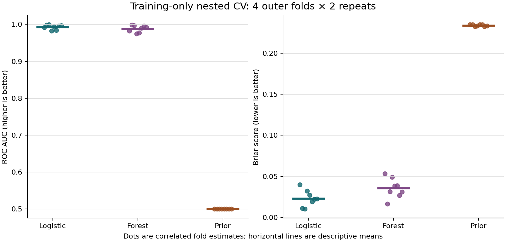
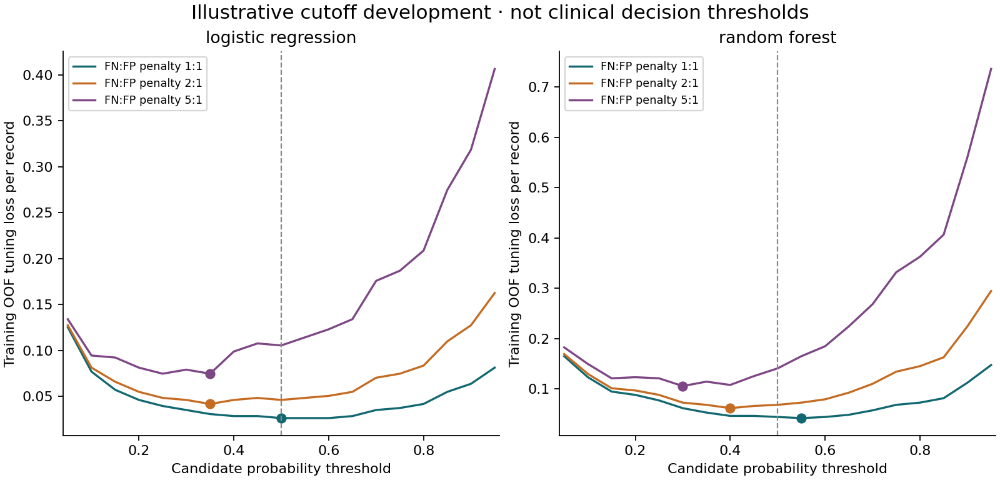
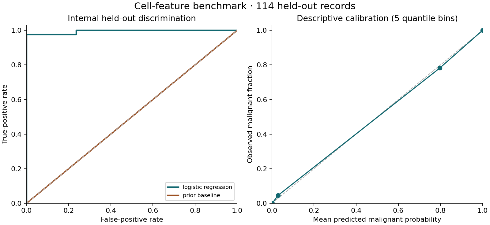

# Cell-feature model validation

**A study of how model tuning, data splits, and decision thresholds affect evaluation.**

## Why this project

**New here? [Read the project background, purpose, and key themes](docs/project-context.md).**

[Understand the sampled biology and prediction concepts](docs/biology-and-concepts.md) · [Explore the conditional prevalence scenarios](docs/prevalence-sensitivity.md).

This project compares a scaled logistic regression, a small random forest, and a prior-only baseline on the Wisconsin Diagnostic Breast Cancer dataset. The input is 30 cell-image features (numerical summaries of nuclear appearance) across 569 records ([Wolberg et al., 1993](https://doi.org/10.24432/C5DW2B)). It is a biological-feature classification example, not a genomics dataset, clinical tool, or new cancer finding.

The project separates model selection, threshold selection, and performance assessment, then examines the limits of that separation. Version 0.2 adds repeated nested cross-validation, which tunes models inside each training partition, and cross-fitted threshold development, which uses predictions made without the corresponding record. It also summarizes uncertainty and records which data have already been inspected.

**The 114-record holdout was inspected in version 0.1.** We preserve it and keep it out of all computation used to develop models and thresholds. Its new results are descriptive replication, not fresh blind validation. The main new investigation uses the other 455 records.

## What it does

1. Keeps the original 455/114 split, verified by a stored index fingerprint.
2. Runs four outer stratified folds twice on the development data. In every outer training partition, three inner folds tune each model separately.
3. Reports each outer-fold score, selected settings, and a descriptive summary of the eight correlated estimates.
4. Builds cross-fitted development probabilities: each record is predicted only by pipelines fitted and tuned without that record. The two repeat predictions are averaged for threshold development.
5. Uses those development predictions to compare illustrative false-negative:false-positive penalties of 1:1, 2:1, and 5:1. All thresholds come from a fixed candidate grid.
6. Fits final pipelines using development data, then describes their performance on the previously observed holdout. No holdout result feeds back into the script's choices.

The code saves aggregate results and data fingerprints. It exports no patient identifiers, row-level predictions, or deployable model.

A separate candidate-file preflight now checks feature names, finite values, label direction, provenance declarations, and exact numerical overlap with the benchmark. It fits no model and does not establish that a new dataset is suitable for external validation.

## Quick start

Use Python 3.12 from this repository's root. The dataset comes with scikit-learn, so the analysis runs offline once dependencies are installed.

```sh
python -m venv .venv
# macOS/Linux:
source .venv/bin/activate
# Windows PowerShell instead: .venv\Scripts\Activate.ps1
python -m pip install -r requirements.txt
python -m unittest discover -s tests -v
python -m cell_validation --output-dir reproduced-results
python scripts/check_reproduction.py reproduced-results
```

The default workload uses small parameter grids and 100 trees per forest. The complete study took about 21 seconds in the tested environment; timing will vary with hardware. The commands write aggregate tables, JSON reports, and four figures to `reproduced-results/`, then compare the numerical results with the checked-in files in `results/`. This keeps the reference outputs available for comparison.

Try the input contract on explicitly synthetic feature values:

```sh
python -m cell_validation.preflight \
  --data examples/synthetic_features.csv \
  --metadata examples/synthetic_metadata.json
```

See [the expected aggregate report](examples/preflight_report.json) and [contract](docs/practical-use.md) before supplying another file.

A [30-feature mapping template](templates/feature-map-v1.json) records definitions, units, upstream transformations, and review declarations. To require a complete, CSV-bound record using the explicitly synthetic example:

```sh
python -m cell_validation.preflight --data examples/synthetic_features.csv --metadata examples/synthetic_metadata.json --feature-map examples/synthetic_feature_map.json --require-feature-map
```

Read [the mapping guide](docs/feature-mapping.md) before filling a template. The command checks declarations; it does not verify their scientific truth or apply transformations.

## Example results



In the checked-in run, logistic regression's mean outer-fold area under the receiver operating characteristic curve (ROC AUC, a ranking measure) was **0.9928**, compared with **0.9886** for the forest and **0.5000** for the prior baseline. Mean Brier scores (squared probability errors) were **0.0230**, **0.0356**, and **0.2340**, respectively. The dots are overlapping fold estimates, not eight independent experiments. We do not turn their standard deviation into a confidence interval or claim that this small difference establishes model superiority.



Changing the illustrative penalty changed the selected cutoff. For logistic regression it was **0.50** under equal penalties and **0.35** when false negatives received twice the weight. These are teaching assumptions, not clinical valuations. The plotted quantity was minimized on the same cross-fitted development labels, so it is a **tuning loss**, not an unbiased estimate of future cost.

The lower logistic cutoff did not improve the historical holdout: it added a false positive without removing its one false negative. A choice that helps on development data need not help in another sample. Read [the findings](docs/findings.md) for the full interpretation.



The calibration bars are pointwise Wilson intervals (uncertainty intervals for each observed fraction separately) for observed bin fractions. They are not simultaneous uncertainty bands for the calibration function. The small sample, estimated probabilities, and data reuse all limit the conclusion.

### What if the base rate changes?

The prevalence exercise asks how the fraction of positive labels affects positive and negative predictive values (PPV and NPV). These values describe the fraction of positive or negative calls with the corresponding reference label. The calculation holds the existing logistic cutoffs and historical sensitivity/specificity fixed, then varies the assumed positive-label fraction from 1% to 50%.

These mathematical scenarios assume that the historical rates transfer to the new population; that assumption is untested. They provide no new screening results or individual risk recalibration. [Read the generated report](results/prevalence_report.md) for the table and curves. This step retrains no model and changes no cutoff.

## Practical use and limitations

A familiar public benchmark can teach a workflow, but cannot establish clinical utility, fairness across populations, or performance under different acquisition practices. Neither associations nor forest splits identify biological mechanisms. Discrimination (ranking) and calibration (agreement between predicted probabilities and observed frequencies) are different properties ([Van Calster et al., 2019](https://doi.org/10.1186/s12916-019-1466-7)).

The [practical guide](docs/practical-use.md) separates implemented input checks, operator responsibilities, and future external evaluation. Exact overlap can expose reused benchmark vectors; a negative check cannot establish independence. Passing the schema check does not establish equivalent acquisition procedures, feature units, or label ascertainment.

Mapping checks are optional unless `--require-feature-map` is used. Even a complete declaration record reports `semantic_compatibility_established: false`, while the historical holdout keeps its previously observed status.

## Documentation

[Glossary](docs/glossary.md) · [Assumptions and justifications](docs/assumptions.md) · [Reference audit](docs/reference-audit.json) · [Review record, 20 October 2026](docs/review-2026-10-20.md)

[Maintenance review, 21 October 2026](docs/review-2026-10-21.md) records the current documentation, source and reproduction checks.

| Guide | What it covers |
| --- | --- |
| [Project context](docs/project-context.md) | Background, question, and key themes |
| [Biology and concepts](docs/biology-and-concepts.md) | Cell morphology, prediction, and interpretation |
| [Methods](docs/methods.md) | Data roles, cross-validation, thresholds, uncertainty |
| [Analysis plan](docs/analysis-plan.md) | Prespecified settings and retained historical split |
| [References](docs/references.md) | Scientific and implementation sources |
| [Data provenance](docs/data-provenance.md) | Public source, transformations, license, fingerprints |
| [Practical use](docs/practical-use.md) | Candidate-file contract, limits, and next steps |
| [Literature review](docs/literature-review.md) | Bounded evidence appraisal and resulting changes |
| [Search log](docs/search-log.json) | Search queries, retrieved records, screening decisions |
| [Round 2 evidence update](docs/search-update-02.json) | Same-day search on measurement heterogeneity |
| [Feature mapping](docs/feature-mapping.md) | Template, optional checks, required-map mode, and boundaries |
| [Reporting map](docs/reporting-map.md) | Lessons and remaining gaps from reporting guidelines |
| [Verification record](docs/verification.md) | Tests and reproduction history |

### Result files worth opening

| File | What it tells you |
| --- | --- |
| `results/nested_cv_folds.csv` | Every outer-fold estimate, split fingerprints, and selected settings |
| `results/nested_cv_summary.csv` | Descriptive means, SDs, and ranges; folds are correlated |
| `results/threshold_selection.csv` | Cutoffs selected only from cross-fitted development predictions |
| `results/threshold_tuning_curves.csv` | Every candidate cutoff and its development tuning loss |
| `results/holdout_thresholds.csv` | Descriptive historical-holdout results at those fixed cutoffs |
| `results/calibration_bins.csv` | Bin counts, observed fractions, and pointwise intervals |
| `results/prevalence_sensitivity.csv` | Conditional PPV/NPV at five assumed prevalences and the existing logistic cutoffs |
| `results/metrics.json` | Data/split fingerprints, parameters, versions, metrics, and scoped bootstrap intervals |
| `docs/version-0.1-results.json` | The earlier published results, preserved for transparency |

[The analysis plan](docs/analysis-plan.md) records the choices. [Methods](docs/methods.md) explains the mathematics and separation of data roles. [The reporting map](docs/reporting-map.md) draws practical lessons from [TRIPOD+AI (Collins et al., 2024)](https://doi.org/10.1136/bmj-2023-078378), a reporting guideline, and [PROBAST+AI (Moons et al., 2025)](https://doi.org/10.1136/bmj-2024-082505), a risk-of-bias/applicability tool while identifying gaps. It is not a claim of formal guideline compliance or low risk of bias.

## Development and reuse

The code is MIT-licensed. The upstream dataset is CC BY 4.0 and has separate attribution requirements; see [data provenance](docs/data-provenance.md). This project was developed with AI assistance. Automated checks support reproducibility; they do not replace scientific review. Small, documented contributions are welcome through [the contribution guide](CONTRIBUTING.md).

Full author–year citations, software versions and the scope of each source are in [references](docs/references.md) and the [reference audit](docs/reference-audit.json).
