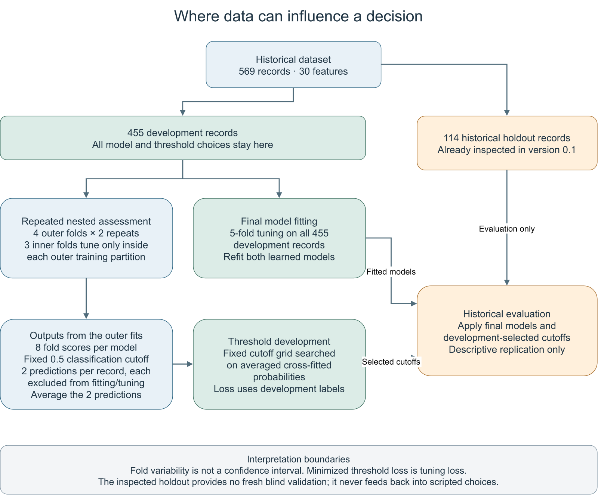

# A visual map of development and assessment

The diagram separates the three places where data are used: model development, threshold development, and descriptive evaluation on an already inspected holdout. It explains the protocol in [Methods](methods.md); it introduces no new fitted model or performance result.



The diagram focuses on the learned model families. The prior-only comparator remains part of the analysis. Eight outer-fold scores are produced **per model**, and those scores are correlated because folds share training records and repeats reuse evaluation records. The fixed 0.5 cutoff applies to classification metrics; ROC AUC and Brier score do not depend on that cutoff.

The same outer fits produce cross-fitted probabilities: each record is excluded from the fitting and tuning that produce its two predictions. Averaging those predictions does not make the subsequently minimized threshold loss unbiased. Threshold selection reuses the development labels. The historical holdout contributes neither model settings nor cutoffs to the script, but its earlier inspection prevents a fresh blind-validation claim.

## Editable sources and provenance

- [draw.io source](figures/data-roles/data-roles.drawio): edit in draw.io Desktop.
- [SVG](figures/data-roles/data-roles.svg): native vector text, suitable for Inkscape.
- [PNG](figures/data-roles/data-roles.png): browser/GitHub preview.
- [Source manifest](figures/data-roles/source-manifest.json): counts and the LF-normalized SHA-256 of `results/metrics.json`.
- [Generator](../scripts/build_data_roles_diagram.py): standard-library Python; layout text follows the methods guide.

The source fingerprint normalizes CRLF to LF only, so Git text checkout conventions do not create a spurious mismatch. It identifies the metrics file used to explain the protocol; it does not validate the underlying experiment. Existing result files remain unchanged.

## Regenerate

From the repository root:

```sh
python scripts/build_data_roles_diagram.py
draw.io --export --format svg --output docs/figures/data-roles/data-roles.svg docs/figures/data-roles/data-roles.drawio
inkscape docs/figures/data-roles/data-roles.svg --export-type=png --export-width=1600 --export-background=white --export-background-opacity=1 --export-filename=docs/figures/data-roles/data-roles.png
```

Use the installed executable paths if the applications are not on `PATH`; Windows installations can use `draw.io.exe` and `inkscape.com`. The recorded exports used draw.io 32.6.1 and Inkscape 1.4.4. The generator overwrites its diagram and manifest in the destination directory; `--output-dir` can preserve an earlier copy.

Open the generated SVG/PNG after editing. Labels use explicit newlines and `html=0`, with automatic text wrapping disabled, so the SVG contains native text rather than HTML `foreignObject` labels. Check arrow direction, readable text, and the distinction between threshold tuning loss and independent assessment before reusing the figure.
