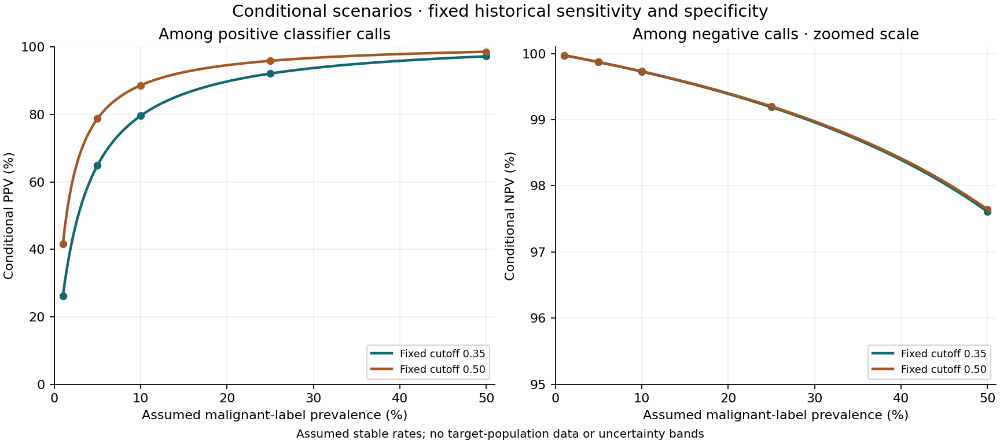

# Conditional prevalence sensitivity

These are mathematical scenarios using fixed logistic-regression cutoffs already selected from development predictions. Sensitivity and specificity are descriptive estimates from the **previously observed holdout**, not new population measurements.

Only the assumed malignant-label fraction changes. No model is refitted, no threshold is reselected, and no target prevalence is estimated. Stable class-conditional performance is an assumption, not a finding.

| Existing cutoff | Assumed prevalence | Conditional PPV | Conditional NPV |
| ---: | ---: | ---: | ---: |
| 0.35 | 1.00% | 26.20% | 99.98% |
| 0.35 | 5.00% | 64.91% | 99.87% |
| 0.35 | 10.00% | 79.61% | 99.73% |
| 0.35 | 25.00% | 92.13% | 99.19% |
| 0.35 | 50.00% | 97.23% | 97.61% |
| 0.50 | 1.00% | 41.52% | 99.98% |
| 0.50 | 5.00% | 78.72% | 99.87% |
| 0.50 | 10.00% | 88.65% | 99.73% |
| 0.50 | 25.00% | 95.91% | 99.20% |
| 0.50 | 50.00% | 98.60% | 97.64% |

The NPV panel uses a zoomed y-axis. Lines hold operating rates fixed; points mark the five tabulated assumptions. Neither line is a confidence band or a prediction for a real screening program.

The estimates use 42 malignant and 72 benign holdout records. Their sampling error and possible changes in case mix, measurement, or labeling are not propagated. A lower base rate can reduce PPV despite unchanged assumed sensitivity and specificity; it does not demonstrate a change in individual biology.

For the equations and limits, read [prevalence methods](../docs/prevalence-sensitivity.md) and [biology and concepts](../docs/biology-and-concepts.md).
